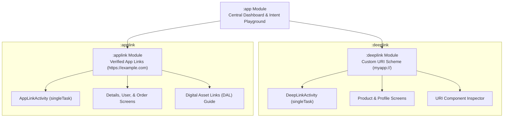

# 🔗 Android Deep Link & App Link Master Demo

A modular, production-ready Android demonstration project built with **Jetpack Compose**, **Kotlin**, and a **Multi-Module Architecture** to showcase and master **Deep Links** and **Android App Links**. 

Designed specifically as a practical reference and interview preparation guide for Android Engineers (Junior to Staff level).

---

## 📚 Essential Documentation

This repository contains in-depth documentation prepared for architecture reviews and technical interviews:

| Document | Description |
| :--- | :--- |
| 📖 [**Implementation Guide**](docs/IMPLEMENTATION_GUIDE.md) | Complete step-by-step implementation guide covering manifest intent filters, URI data parsing, activity lifecycles (`onCreate` vs. `onNewIntent`), Digital Asset Links (`assetlinks.json`), domain verification state machines, and testing. |
| 🎯 [**Top 10 Interview Questions & Answers**](docs/INTERVIEW_QUESTIONS.md) | High-yield Android technical interview questions covering Deep Link vs. App Link differences, Android 12+ changes, link hijacking mitigation, launch modes, deferred deep linking, and security best practices. |

---

## 🏗️ Project Architecture & Modules

The application is structured into three clean, decoupled modules:



### Module Breakdown:
1. **`:app` (Application Harness)**:
   - Central Launcher and Navigation Hub.
   - Houses the **Intent Playground & Resolver** to test link dispatches live in-app.
   - Provides safe explicit and implicit routing via `AppRouter`.
2. **`:deeplink` (Feature Library)**:
   - Demonstrates **Custom Scheme Deep Links** (`myapp://deeplink/*`).
   - Handles `ProductDetailScreen`, `ProfileScreen`, and a visual **URI Inspector**.
   - Illustrates intent filter matching, query parameter parsing, and the Disambiguation Dialog behavior.
3. **`:applink` (Feature Library)**:
   - Demonstrates **Verified Android App Links** (`https://www.example.com/*`).
   - Configured with `android:autoVerify="true"`.
   - Includes sample `assetlinks.json` asset, verification status indicators, and fallback behavior.

---

## ⚡ Concept Summary: Deep Link vs. Android App Link

```
┌───────────────────────────────────────┬───────────────────────────────────────┐
│       Deep Link (Custom Scheme)       │      Android App Link (Verified)      │
├───────────────────────────────────────┼───────────────────────────────────────┤
│ • URI: myapp://deeplink/product/101   │ • URI: https://www.example.com/details│
│ • Scheme: Custom ("myapp")            │ • Scheme: Standard ("https" / "http") │
│ • Verification: None                  │ • Verification: Digital Asset Links   │
│ • Dialog: Shows "Open with..." if     │ • Dialog: None! Opens app directly    │
│   multiple apps claim the scheme      │ • Fallback: Opens webpage in browser  │
│ • Security: Can be hijacked           │ • Security: Cryptographically verified│
└───────────────────────────────────────┴───────────────────────────────────────┘
```

---

## 🛠️ Tech Stack & Prerequisites

- **Language**: Kotlin 2.2+
- **UI Framework**: Jetpack Compose (Material 3)
- **Navigation**: Navigation Compose 2.9+
- **Build System**: Gradle 9.6 with Android Gradle Plugin (AGP) 9.5+
- **Minimum SDK**: Android 7.0 (API 24)
- **Target / Compile SDK**: Android 16 (API 37)

---

## 🚀 Quick Start & Testing with ADB

You can trigger any link via the in-app **Interactive Playground** or directly using ADB from your terminal:

### 1. Test Custom Scheme Deep Links:
```bash
# Product Details with query params
adb shell am start -a android.intent.action.VIEW -d "myapp://deeplink/product/101?ref=promo_banner"

# User Profile Screen
adb shell am start -a android.intent.action.VIEW -d "myapp://deeplink/profile/varsha_dev"

# URI Inspector
adb shell am start -a android.intent.action.VIEW -d "myapp://deeplink/inspector?category=books&page=1"
```

### 2. Test Verified Android App Links:
```bash
# Details Screen
adb shell am start -a android.intent.action.VIEW -d "https://www.example.com/details/42?source=newsletter"

# Order Screen
adb shell am start -a android.intent.action.VIEW -d "https://www.example.com/order/ORD-98765"

# User Profile Screen
adb shell am start -a android.intent.action.VIEW -d "https://www.example.com/user/alex_coder"
```

### 3. Check & Manage Domain Verification:
```bash
# Query verification state for the app
adb shell pm get-app-links android.ai.applinkanddeeplink

# Force re-verification
adb shell pm verify-app-links --re-verify android.ai.applinkanddeeplink

# Manually verify domains on an emulator (State 2 = verified)
adb shell pm set-app-links --package android.ai.applinkanddeeplink 2 www.example.com example.com
```

---

## 📖 Further Reading
For full technical explanations, architectural diagrams, and top interview questions:
- [Implementation Guide (docs/IMPLEMENTATION_GUIDE.md)](docs/IMPLEMENTATION_GUIDE.md)
- [Top 10 Interview Questions & Answers (docs/INTERVIEW_QUESTIONS.md)](docs/INTERVIEW_QUESTIONS.md)
