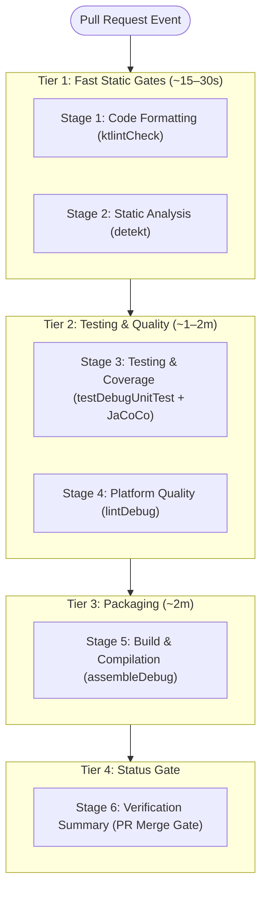

# 🚀 Android CI/CD with GitHub Actions: Architecture Guide & Top 10 Interview Questions

> A comprehensive, production-grade guide to designing, writing, and optimizing [`.github/workflows/android-ci.yml`](../.github/workflows/android-ci.yml) for Android projects, followed by the **Top 10 High-Yield Android CI/CD Technical Interview Questions and Answers** for Mid, Senior, and Staff Android Engineers.

---

## 📑 Table of Contents

- [Part 1: How to Write and Architect `android-ci.yml`](#part-1-how-to-write-and-architect-android-ciyml)
  - [1. Core Anatomy of an Enterprise Android Workflow](#1-core-anatomy-of-an-enterprise-android-workflow)
  - [2. Triggers, Branch Filtering & Concurrency Control](#2-triggers-branch-filtering--concurrency-control)
  - [3. Runner Environment & JVM Configuration (JDK 21 & Node 24)](#3-runner-environment--jvm-configuration-jdk-21--node-24)
  - [4. High-Performance Caching Strategy](#4-high-performance-caching-strategy)
  - [5. The "Fail-Fast" Tiered Pipeline Architecture](#5-the-fail-fast-tiered-pipeline-architecture)
  - [6. Step-by-Step Stage Breakdown](#6-step-by-step-stage-breakdown)
  - [7. Artifacts, Test Reports & Coverage Publishing](#7-artifacts-test-reports--coverage-publishing)
  - [8. Critical CI Anti-Patterns to Avoid](#8-critical-ci-anti-patterns-to-avoid)
- [Part 2: Top 10 Android CI/CD Technical Interview Questions](#part-2-top-10-android-cicd-technical-interview-questions)
  - [Q1: How do you optimize Android CI build times in GitHub Actions?](#q1-how-do-you-optimize-android-ci-build-times-in-github-actions)
  - [Q2: What is the "Fail-Fast" tiered pipeline architecture, and why is running `:app:assembleDebug` first an anti-pattern?](#q2-what-is-the-fail-fast-tiered-pipeline-architecture-and-why-is-running-appassembledebug-first-an-anti-pattern)
  - [Q3: How does the GitHub Actions runner runtime migration (Node 20 to Node 24) affect actions, and how do you resolve action deprecations?](#q3-how-does-the-github-actions-runner-runtime-migration-node-20-to-node-24-affect-actions-and-how-do-you-resolve-action-deprecations)
  - [Q4: Why is committing `org.gradle.java.home` to `gradle.properties` an anti-pattern, and how should JVM toolchains be configured across local and CI runners?](#q4-why-is-committing-orggradlejavahome-to-gradleproperties-an-anti-pattern-and-how-should-jvm-toolchains-be-configured-across-local-and-ci-runners)
  - [Q5: How do you manage and prevent flaky Robolectric & Compose UI tests on headless Linux CI containers?](#q5-how-do-you-manage-and-prevent-flaky-robolectric--compose-ui-tests-on-headless-linux-ci-containers)
  - [Q6: What is the difference between Gradle Build Cache, Configuration Cache, and GitHub Actions `actions/cache`? How do they interact?](#q6-what-is-the-difference-between-gradle-build-cache-configuration-cache-and-github-actions-actionscache-how-do-they-interact)
  - [Q7: Why should `org.gradle.daemon=false` be set in CI environments, and what are the trade-offs?](#q7-why-should-orggradledaemonfalse-be-set-in-ci-environments-and-what-are-the-trade-offs)
  - [Q8: How do you enforce strict Android Lint security rules and platform compliance in CI without blocking developer productivity?](#q8-how-do-you-enforce-strict-android-lint-security-rules-and-platform-compliance-in-ci-without-blocking-developer-productivity)
  - [Q9: How do you implement workflow concurrency control (`cancel-in-progress`) in GitHub Actions, and why is it critical for Android PR builds?](#q9-how-do-you-implement-workflow-concurrency-control-cancel-in-progress-in-github-actions-and-why-is-it-critical-for-android-pr-builds)
  - [Q10: How do you securely handle Android signing keys, keystores, and API credentials in GitHub Actions without leaking them to PR forks?](#q10-how-do-you-securely-handle-android-signing-keys-keystores-and-api-credentials-in-github-actions-without-leaking-them-to-pr-forks)

---

# Part 1: How to Write and Architect `android-ci.yml`

## 1. Core Anatomy of an Enterprise Android Workflow

A production-grade Android GitHub Actions workflow must balance **three competing forces**:
1. **Feedback Velocity**: Developers need immediate signals (<30 seconds) on trivial mistakes like formatting or import errors.
2. **Resource Efficiency**: Mobile CI jobs are CPU- and RAM-heavy; redundant builds waste runner minutes and developer time.
3. **Quality Guarantees**: Pull requests must never break `master`, degrade test coverage, or introduce security vulnerabilities.

```
.github/workflows/android-ci.yml
├── Name & Triggers (pull_request, push, concurrency)
├── Permissions & Security Scopes
├── Global Environment Variables (JDK, Gradle JVM flags, Node runtime)
└── Jobs (Tiered Pipeline Architecture)
    ├── Tier 1 (Fast Static Gates)  → ktlintCheck, detekt
    ├── Tier 2 (Testing & Quality)   → testDebugUnitTest, lintDebug
    ├── Tier 3 (Packaging)           → assembleDebug
    └── Tier 4 (Status Gate)         → verification-summary (PR merge blocker)
```

---

## 2. Triggers, Branch Filtering & Concurrency Control

```yaml
name: Android CI - Pull Request Verification

on:
  push:
    branches:
      - git-action-setup
  pull_request:
    branches:
      - master
    types: [opened, synchronize, reopened]

concurrency:
  group: ci-${{ github.head_ref || github.ref }}
  cancel-in-progress: true
```

### Why this configuration?
- **`branches: [master]`**: Ensures the workflow runs whenever code intends to merge into the production branch.
- **`types: [opened, synchronize, reopened]`**: Runs when a PR is first opened, whenever a new commit is pushed (`synchronize`), or when reopened.
- **`concurrency.cancel-in-progress: true`**: If a developer pushes commit `A` and immediately pushes commit `B`, GitHub Actions **cancels the build for `A` immediately**. This saves hours of runner time and prevents queue congestion.

---

## 3. Runner Environment & JVM Configuration (JDK 21 & Node 24)

```yaml
permissions:
  contents: read
  checks: write
  pull-requests: write

env:
  JAVA_DISTRIBUTION: 'temurin'
  JAVA_VERSION: '21'
  GRADLE_OPTS: '-Dorg.gradle.daemon=false -Dorg.gradle.parallel=true -Dorg.gradle.jvmargs="-Xmx4g -Dfile.encoding=UTF-8"'
  FORCE_JAVASCRIPT_ACTIONS_TO_NODE24: true
```

### Key Elements:
1. **`permissions`**:
   - `contents: read`: Least privilege principle to inspect code.
   - `checks: write` & `pull-requests: write`: Required for actions like `dorny/test-reporter` to post test outcome check runs directly onto the PR.
2. **`JAVA_DISTRIBUTION: 'temurin'` & `JAVA_VERSION: '21'`**:
   - Modern Android (AGP 8.x/9.x, Kotlin 2.x, CompileSdk 34–37) requires Java 17 or Java 21. Eclipse Temurin is the industry standard for stable, performant OpenJDK builds.
3. **`GRADLE_OPTS`**:
   - `-Dorg.gradle.daemon=false`: In ephemeral CI containers, a running daemon consumes RAM and won't be reused after the container terminates.
   - `-Dorg.gradle.parallel=true`: Decoupled multi-module tasks compile concurrently across available runner vCPUs.
   - `-Xmx4g`: Sets maximum JVM heap to 4GB, preventing Linux Out-Of-Memory (`OOM-killer`) exits on GitHub runner instances (standard runners have 7GB RAM).
4. **`FORCE_JAVASCRIPT_ACTIONS_TO_NODE24: true`**:
   - Overcomes GitHub's deprecation of Node.js 20 and enforces native execution on Node.js 24 without runner warnings or forced-execution failures.

---

## 4. High-Performance Caching Strategy

```yaml
- name: Set up JDK 21
  uses: actions/setup-java@v5
  with:
    distribution: ${{ env.JAVA_DISTRIBUTION }}
    java-version: ${{ env.JAVA_VERSION }}

- name: Cache Gradle Packages
  uses: actions/cache@v5
  with:
    path: |
      ~/.gradle/caches
      ~/.gradle/wrapper
    key: gradle-${{ runner.os }}-${{ hashFiles('**/*.gradle.kts', '**/gradle-wrapper.properties', '**/libs.versions.toml') }}
    restore-keys: gradle-${{ runner.os }}-
```

### Why this key pattern?
- **`hashFiles(...)`**: The cache key changes **only** when dependencies or plugins change (`*.gradle.kts`, `gradle-wrapper.properties`, or `libs.versions.toml`).
- **`restore-keys` fallback**: If an exact match is not found, GitHub Actions restores the most recent Gradle cache, saving 3–5 minutes of downloading common dependencies from Google and Maven Central.

---

## 5. The "Fail-Fast" Tiered Pipeline Architecture

Instead of executing tasks sequentially or running the heavy APK compilation first, the workflow organizes tasks into **four progressive tiers**:



### Benefits of Tiering:
1. **Developer Happiness**: If a file has trailing whitespace, the build fails in **20 seconds**. The developer fixes it immediately rather than waiting 6 minutes.
2. **Saves CI Minutes**: If Tier 1 fails, Tiers 2, 3, and 4 **never execute**, saving GitHub Actions billable minutes.
3. **Clean Artifacts**: APKs are only generated for commits that have already proven to be architecturally and logically sound.

---

## 6. Step-by-Step Stage Breakdown

### Stage 1: Code Formatting (`:app:ktlintCheck`)
- Runs official Kotlin coding style checks.
- Verifies line lengths, import ordering, wildcard import bans, and naming standards.

### Stage 2: Static Analysis (`:app:detekt`)
- Parses Kotlin AST to identify code complexity, magic numbers, empty catch blocks, and deeply nested logic.
- Publishes `detekt.html` as a downloadable artifact.

### Stage 3: Testing & Coverage (`:app:testDebugUnitTest :app:jacocoTestReport`)
- Executes all local Unit tests, Robolectric Compose UI behavior tests, and Konsist architecture/security rules.
- Generates JUnit XML and JaCoCo coverage reports.

### Stage 4: Platform Quality (`:app:lintDebug`)
- Inspects AndroidManifest configurations, XML resource validity, layout inflation performance, and Android API deprecations.
- Enforces strict security escalation (`error.add("Security")` in `app/build.gradle.kts`).

### Stage 5: Build & Compilation (`:app:assembleDebug`)
- Runs Kotlin compiler, Android resource processing, R-class generation, DEX transformation, and APK packaging.
- Produces and uploads `app-debug.apk`.

### Stage 6: Final Verification Summary
- Evaluates `needs: [code-style, static-analysis, unit-tests, platform-lint, build-apk]`.
- Exits with `code 0` if all pass, or `code 1` if any stage failed, providing a clean check for GitHub PR branch protection rules.

---

## 7. Artifacts, Test Reports & Coverage Publishing

```yaml
# Publish interactive check run on the PR
- name: Publish JUnit Test Results
  if: always()
  uses: dorny/test-reporter@v3
  with:
    name: 'Unit & Robolectric Test Results'
    path: 'app/build/test-results/testDebugUnitTest/*.xml'
    reporter: java-junit
    fail-on-error: false

# Archive HTML Coverage Report for download
- name: Upload JaCoCo Coverage Report
  if: always()
  uses: actions/upload-artifact@v5
  with:
    name: jacoco-coverage-report
    path: app/build/reports/jacoco/jacocoTestReport/html/
    retention-days: 14
```

> [!TIP]
> Always use `if: always()` on reporting steps so that test results and reports are captured and uploaded even when tests fail!

---

## 8. Critical CI Anti-Patterns to Avoid

| Anti-Pattern | Why it Fails | What to Do Instead |
|---|---|---|
| **Hardcoding `org.gradle.java.home` in `gradle.properties`** | Paths like `C:/Users/Name/...` break on Linux CI runners. | Remove it from project `gradle.properties`. Use `actions/setup-java@v5` and `gradle-daemon-jvm.properties`. |
| **Running `:app:assembleDebug` first** | Wastes 2–3 minutes compiling code that might violate basic code style rules. | Run `ktlintCheck` and `detekt` first in Tier 1. |
| **Omitting `chmod +x ./gradlew`** | Git on Windows does not always preserve Linux executable permissions (`100755`), causing `Permission Denied`. | Always add `run: chmod +x ./gradlew` before Gradle commands. |
| **Leaving Gradle Daemon Enabled in CI** | Multiple jobs or long-running daemons leak memory and crash ephemeral containers with OOM. | Pass `-Dorg.gradle.daemon=false` in `GRADLE_OPTS`. |
| **Not Cancelling Obsolete PR Runs** | Pushing 3 quick commits triggers 3 concurrent full builds. | Add `concurrency: { group: ..., cancel-in-progress: true }`. |

---

# Part 2: Top 10 Android CI/CD Technical Interview Questions

---

### Q1: How do you optimize Android CI build times in GitHub Actions?

#### 💡 Core Answer:
Android CI optimization requires attacking four bottlenecks: **Dependency resolution, compilation cache hits, test execution overhead, and runner hardware utilization**.

```
┌────────────────────────────────────────────────────────────────────────┐
│                   Android CI Optimization Hierarchy                    │
├───────────────────────┬────────────────────────────────────────────────┤
│ 1. Caching Layers     │ GitHub Actions cache + Gradle Configuration    │
│                       │ Cache + Local/Remote Gradle Build Cache        │
├───────────────────────┼────────────────────────────────────────────────┤
│ 2. Pipeline Topology  │ Fail-Fast Tiering (Static gates before builds) │
├───────────────────────┼────────────────────────────────────────────────┤
│ 3. Concurrency        │ Cancel obsolete runs + Parallel modular Gradle │
├───────────────────────┼────────────────────────────────────────────────┤
│ 4. Test Optimization  │ Forking Robolectric + Headless test filtering  │
└───────────────────────┴────────────────────────────────────────────────┘
```

#### 🔍 Deep Dive Details:
1. **Multi-layer Caching**:
   - Cache `~/.gradle/caches` and `~/.gradle/wrapper` using `actions/cache@v5`.
   - Enable Gradle Configuration Cache (`org.gradle.configuration-cache=true`) to skip configuration on incremental runs.
   - Enable local or remote Gradle Build Cache (`--build-cache`).
2. **Fail-Fast Parallelization**:
   - Run lightweight tasks (`ktlint`, `detekt`) in parallel before initiating compilation.
3. **Targeted Task Execution**:
   - Never run `./gradlew build` in CI. `build` executes both debug and release variants, lint for all variants, and connected check tasks. Instead, invoke specific variant tasks: `:app:assembleDebug` and `:app:testDebugUnitTest`.
4. **Gradle JVM Memory Tuning**:
   - Avoid generic `org.gradle.jvmargs`. For standard GitHub-hosted 2-core runners (7GB RAM), set `-Xmx4g -XX:+UseG1GC -Dfile.encoding=UTF-8`.

---

### Q2: What is the "Fail-Fast" tiered pipeline architecture, and why is running `:app:assembleDebug` first an anti-pattern?

#### 💡 Core Answer:
The **Fail-Fast Tiered Architecture** organizes CI verification into progressive dependency stages based on execution speed and computational cost: **Static Gates (Tier 1) → Verification & Tests (Tier 2) → Artifact Compilation (Tier 3)**.

Running `:app:assembleDebug` first is an anti-pattern because:
1. **Delayed Feedback Loop**: Packaging an APK involves resource merging, DEXing, and APK signing (~2–3 minutes). If a developer made a syntax error, broke an import, or failed a unit test, they wait minutes instead of seconds for feedback.
2. **Wasted Compute and Money**: In cloud CI, every runner minute is billable. Packaging an APK that is subsequently rejected by a style violation or broken test is wasted compute.
3. **Artifact Integrity Violation**: An artifact should only be built and archived once the source code has proven to be syntactically, architecturally, and functionally correct.

---

### Q3: How does the GitHub Actions runner runtime migration (Node 20 to Node 24) affect actions, and how do you resolve action deprecations?

#### 💡 Core Answer:
GitHub Actions runners run JavaScript actions inside an embedded Node.js runtime. When GitHub deprecated Node.js 20, runners began enforcing execution on Node.js 24. Actions that still target Node.js 20 trigger warnings or fail when runner security policies reject unmaintained runtimes.

#### ⚙️ How to Resolve:
1. **Migrate Core Actions to Modern Versions**:
   - `actions/checkout@v4` → `actions/checkout@v5`
   - `actions/setup-java@v4` → `actions/setup-java@v5`
   - `actions/cache@v4` → `actions/cache@v5`
   - `actions/upload-artifact@v4` → `actions/upload-artifact@v5`
   - `dorny/test-reporter@v1` → `dorny/test-reporter@v3`
2. **Explicit Runner Override**:
   Set `FORCE_JAVASCRIPT_ACTIONS_TO_NODE24: true` in workflow environment variables to ensure compatibility on transitioning runners.

---

### Q4: Why is committing `org.gradle.java.home` to `gradle.properties` an anti-pattern, and how should JVM toolchains be configured across local and CI runners?

#### 💡 Core Answer:
`org.gradle.java.home` in project `gradle.properties` overrides `$JAVA_HOME` on **every machine that clones the repo**. Committing a developer's local path (e.g. `C:/Users/Name/...`) guarantees a CI build failure on Linux:
```
Value 'C:/Users/...' given for org.gradle.java.home Gradle property is invalid
```

#### 🔍 Best-Practice Toolchain Setup:
1. **`gradle/gradle-daemon-jvm.properties`**:
   Declare the expected daemon JVM version portably:
   ```properties
   toolchainVersion=21
   ```
2. **Gradle Java Toolchains in `build.gradle.kts`**:
   ```kotlin
   java {
       toolchain {
           languageVersion.set(JavaLanguageVersion.of(21))
       }
   }
   ```
3. **CI Runner Setup**:
   Let CI set `JAVA_HOME` dynamically using `actions/setup-java@v5`.
4. **Local Overrides**:
   If a developer needs a custom JDK path, they should place `org.gradle.java.home` in their **user-home** `~/.gradle/gradle.properties`, never in the project-level repository file.

---

### Q5: How do you manage and prevent flaky Robolectric & Compose UI tests on headless Linux CI containers?

#### 💡 Core Answer:
Robolectric and Compose UI tests execute on the JVM without an Android device. However, on headless Linux CI runners, flakiness typically stems from **SDK level mismatches, resource exclusions, headless display missing libraries, or memory starvation during concurrent execution**.

#### ⚙️ Mitigation Strategies:
1. **Include Android Resources in `app/build.gradle.kts`**:
   ```kotlin
   testOptions {
       unitTests {
           isIncludeAndroidResources = true
       }
   }
   ```
2. **Explicit Robolectric SDK Pinning**:
   When compiling against preview or cutting-edge SDKs (e.g. SDK 36/37), Robolectric may fail with `IllegalArgumentException: No such SDK`. Pin Robolectric to a stable supported runtime SDK (e.g. SDK 34) in `app/src/test/resources/robolectric.properties`:
   ```properties
   sdk=34
   ```
3. **JVM Memory Allocation for Test Runners**:
   ```kotlin
   tasks.withType<Test> {
       maxParallelForks = (Runtime.getRuntime().availableProcessors() / 2).coerceAtLeast(1)
       jvmArgs("-Xmx2g", "-XX:+UseG1GC")
   }
   ```
4. **Robolectric Graphics Hardware Mode**:
   Set `graphicsMode = GraphicsMode.Mode.NATIVE` to ensure Jetpack Compose canvas and font measurements render deterministically across OS platforms.

---

### Q6: What is the difference between Gradle Build Cache, Configuration Cache, and GitHub Actions `actions/cache`? How do they interact?

#### 💡 Core Answer:
Each cache operates at a fundamentally different layer of the build lifecycle:

```
┌────────────────────────────────────────────────────────────────────────┐
│                        Cache Layers Compared                           │
├────────────────────┬───────────────────────────────────────────────────┤
│ GitHub Cache       │ Caches physical files on disk across CI runs      │
│ (actions/cache)    │ (~/.gradle/caches, downloaded JARs/AARs, SDK)     │
├────────────────────┼───────────────────────────────────────────────────┤
│ Configuration Cache│ Caches the evaluated Gradle Task Execution Graph  │
│ (Gradle Native)    │ Skips configuration phase entirely on replay      │
├────────────────────┼───────────────────────────────────────────────────┤
│ Build Cache        │ Caches outputs of specific tasks based on input   │
│ (local / remote)   │ hashes (skips compileKotlin, dex, etc. as UP-TO-DATE)
└────────────────────┴───────────────────────────────────────────────────┘
```

#### 🔍 Interaction in CI:
1. `actions/cache@v5` downloads the archived `.gradle` directory onto the fresh runner VM.
2. Gradle starts. With **Configuration Cache** enabled, Gradle verifies that build scripts haven't changed and skips the configuration phase entirely.
3. For task execution, Gradle's **Build Cache** checks input hashes. If a task's inputs match previous outputs stored in the restored cache, the task is marked `FROM-CACHE` and execution time drops to near-zero.

---

### Q7: Why should `org.gradle.daemon=false` be set in CI environments, and what are the trade-offs?

#### 💡 Core Answer:
The **Gradle Daemon** is a background process designed to keep JIT-compiled bytecode and in-memory caches warm for interactive local development in Android Studio.

#### In CI Environments:
- **Why Disable (`daemon=false`)**:
  1. **Ephemeral Containers**: GitHub Actions runners are discarded after job completion. A daemon running in the background will never benefit future builds.
  2. **Memory Leaks & OOM**: A background daemon continues holding onto 1.5–3 GB of memory. When a second task (like Dexing or Android Lint) demands memory, the Linux container runs out of RAM and the kernel kills the runner process (`Exit code 137`).
  3. **Process Hanging**: Occasionally, background daemons fail to terminate, causing GitHub Actions jobs to hang until hitting the workflow timeout.
- **The Trade-off**:
  Disabling the daemon increases build time slightly (~5–10s) because the JVM does not retain JIT optimizations across distinct `./gradlew` commands within the same job. However, the stability and memory predictability far outweigh this minor cost.

---

### Q8: How do you enforce strict Android Lint security rules and platform compliance in CI without blocking developer productivity?

#### 💡 Core Answer:
Android Lint checks hundreds of rules across correctness, security, performance, and accessibility. Running blanket `abortOnError = true` on every warning blocks developers on trivial cosmetic issues.

#### ⚙️ The Senior Solution: Selective Escalation
1. **Escalate Critical Categories in `build.gradle.kts`**:
   Treat **Security** and **Correctness** as blocking errors, while leaving cosmetic warnings as non-blocking:
   ```kotlin
   lint {
       abortOnError = true
       checkDependencies = true
       warningsAsErrors = false
       
       // Escalate critical issues to blocking build failures
       error.add("Security")
       error.add("HardcodedDebugMode")
       error.add("ExportedReceiver")
       error.add("ProtectedPermissions")
   }
   ```
2. **Baseline Files for Legacy Technical Debt**:
   For large brownfield applications with thousands of existing warnings, use a Lint baseline file:
   ```kotlin
   lint {
       baseline = file("lint-baseline.xml")
   }
   ```
   This ensures that **no new errors are introduced** in pull requests without blocking developers on pre-existing legacy issues.

---

### Q9: How do you implement workflow concurrency control (`cancel-in-progress`) in GitHub Actions, and why is it critical for Android PR builds?

#### 💡 Core Answer:
Concurrency control groups workflow runs by branch or PR ref and terminates in-flight builds when a newer commit is pushed to the same branch:

```yaml
concurrency:
  group: ci-${{ github.head_ref || github.ref }}
  cancel-in-progress: true
```

#### Why it is critical for Android:
1. **Android CI builds are long (5–15 minutes)**: A developer addressing review feedback often pushes 2 or 3 quick commits within a few minutes.
2. **Prevents Queue Exhaustion**: Without `cancel-in-progress`, every push queues a full build. 3 commits = 30+ minutes of runner consumption.
3. **Eliminates Race Conditions**: Ensures that the status checks displayed on the PR always reflect the **latest commit**, preventing outdated checks from falsely approving a PR.

---

### Q10: How do you securely handle Android signing keys, keystores, and API credentials in GitHub Actions without leaking them to PR forks?

#### 💡 Core Answer:
Handling Android release secrets in CI requires addressing **storage security, log masking, and pull-request fork attack vectors**.

```
┌────────────────────────────────────────────────────────────────────────┐
│                     Secure Secret Pipeline in CI                       │
├────────────────────┬───────────────────────────────────────────────────┤
│ Keystore Storage   │ Base64-encoded string in GitHub Repository Secret │
├────────────────────┼───────────────────────────────────────────────────┤
│ Decryption on CI   │ In-memory or temporary file in $RUNNER_TEMP       │
├────────────────────┼───────────────────────────────────────────────────┤
│ Fork Protection    │ pull_request event never exposes repo secrets     │
├────────────────────┼───────────────────────────────────────────────────┤
│ Cleanup            │ Post-step cleanup deletes decrypted .jks file     │
└────────────────────┴───────────────────────────────────────────────────┘
```

#### ⚙️ Implementation Strategy:
1. **Encode Keystore to Base64**:
   ```bash
   base64 -i my-release-key.jks | tr -d '\n' > keystore_base64.txt
   ```
   Save the output as a GitHub Secret (`RELEASE_KEYSTORE_BASE64`).
2. **Decode Only on Protected Release Workflows**:
   Never run signing on untrusted `pull_request` triggers from forks. Use `workflow_dispatch` or `push: tags: 'v*'`:
   ```yaml
   - name: Decode Keystore
     run: |
       echo "${{ secrets.RELEASE_KEYSTORE_BASE64 }}" | base64 -d > $RUNNER_TEMP/release.jks

   - name: Build Signed Release APK
     env:
       KEYSTORE_PASSWORD: ${{ secrets.KEYSTORE_PASSWORD }}
       KEY_ALIAS: ${{ secrets.KEY_ALIAS }}
       KEY_PASSWORD: ${{ secrets.KEY_PASSWORD }}
     run: |
       ./gradlew :app:assembleRelease \
         -Pandroid.injected.signing.store.file=$RUNNER_TEMP/release.jks \
         -Pandroid.injected.signing.store.password=$KEYSTORE_PASSWORD \
         -Pandroid.injected.signing.key.alias=$KEY_ALIAS \
         -Pandroid.injected.signing.key.password=$KEY_PASSWORD

   - name: Clean Up Keystore
     if: always()
     run: rm -f $RUNNER_TEMP/release.jks
   ```
3. **Protection Against Forks**:
   Standard `pull_request` triggers do not pass repository secrets to runs originating from public forks. Never use `pull_request_target` with an explicit checkout of untrusted PR code, as this allows attackers to print secrets into build logs.

---

## 📌 Summary Checklist for Production Android CI

- [x] **Triggers**: Configured for `pull_request` to `master` with `cancel-in-progress: true`.
- [x] **Environment**: Node 24 actions (`@v5`), JDK 21 via `actions/setup-java@v5`.
- [x] **Permissions**: Minimal required scopes (`contents: read`, `checks: write`, `pull-requests: write`).
- [x] **Pipeline Topology**: Fast static gates first (`ktlint`, `detekt`) → Tests (`testDebugUnitTest`) → Packaging (`assembleDebug`).
- [x] **Memory Management**: `-Dorg.gradle.daemon=false` and explicit `-Xmx4g` heap in `GRADLE_OPTS`.
- [x] **Artifacts & Reports**: JUnit XML, JaCoCo HTML, and Detekt reports uploaded with `retention-days: 14`.
- [x] **Portability**: No machine-specific paths like `org.gradle.java.home` in committed files.
