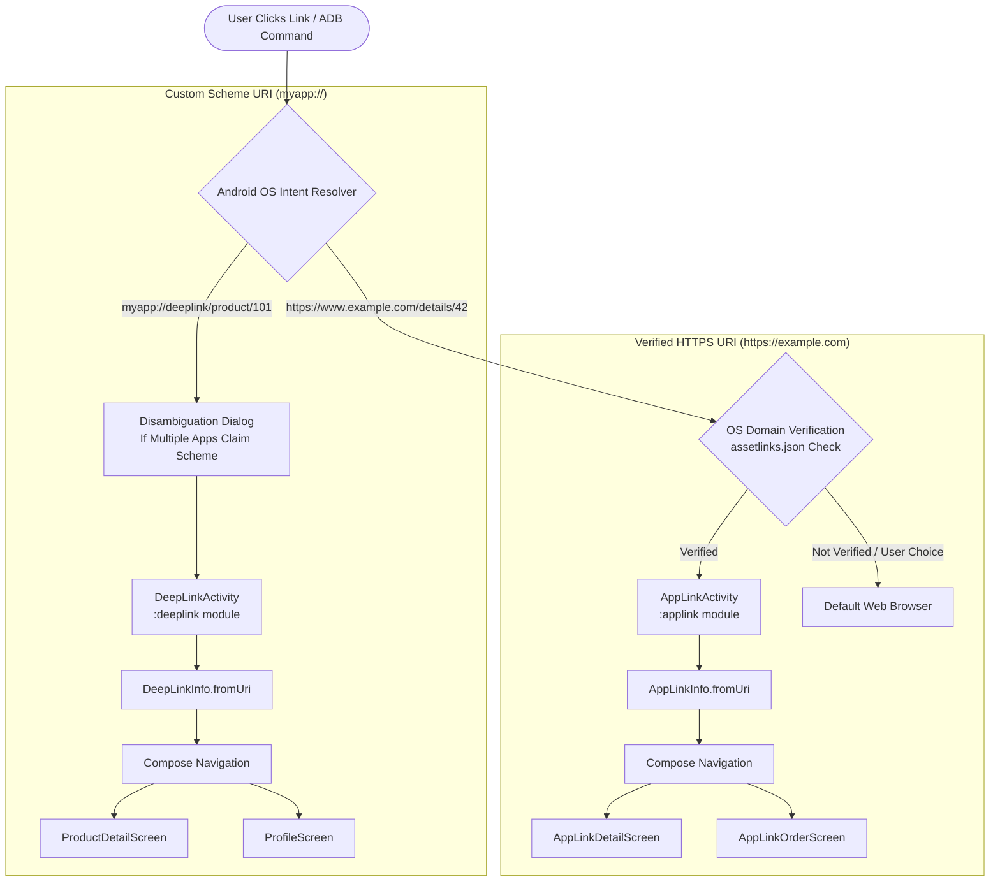
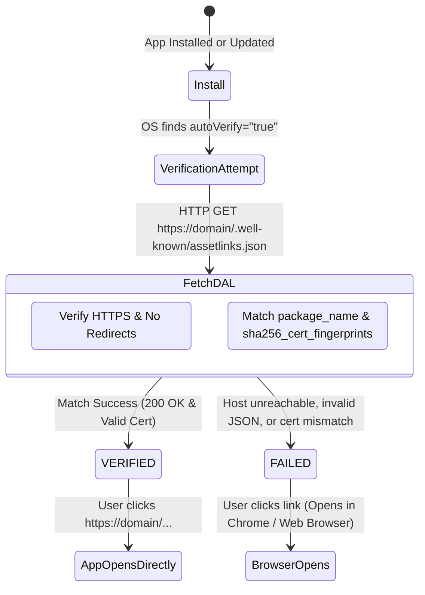

# 📱 Deep Links & Android App Links — Complete Implementation Guide

> A comprehensive, production-grade guide to understanding, architecting, implementing, and testing Deep Links and Android App Links in modern Android with Jetpack Compose and Multi-Module Architecture.

---

## 📑 Table of Contents
1. [Architectural Overview & Module Structure](#1-architectural-overview--module-structure)
2. [Deep Link vs. Web Link vs. Android App Link](#2-deep-link-vs-web-link-vs-android-app-link)
3. [Deep Link Module Implementation (`:deeplink`)](#3-deep-link-module-implementation-deeplink)
   - [Manifest Configuration & Intent Filters](#manifest-configuration--intent-filters)
   - [URI Parsing & Data Extraction Engine](#uri-parsing--data-extraction-engine)
   - [Activity Lifecycle & Launch Modes](#activity-lifecycle--launch-modes)
   - [Jetpack Compose Screen Routing](#jetpack-compose-screen-routing)
4. [App Link Module Implementation (`:applink`)](#4-app-link-module-implementation-applink)
   - [Manifest Configuration with `autoVerify`](#manifest-configuration-with-autoverify)
   - [Digital Asset Links (`assetlinks.json`) Protocol](#digital-asset-links-assetlinksjson-protocol)
   - [Domain Verification State Machine (Android 6.0 to 12+)](#domain-verification-state-machine)
   - [Handling Incoming Verified Links](#handling-incoming-verified-links)
5. [App Module & Central Router (`:app`)](#5-app-module--central-router-app)
   - [Explicit vs. Implicit Intent Dispatch](#explicit-vs-implicit-intent-dispatch)
   - [Interactive Playground & Resolver](#interactive-playground--resolver)
6. [Testing & Verification Guide (ADB Cheatsheet)](#6-testing--verification-guide-adb-cheatsheet)
7. [Production Best Practices & Edge Cases](#7-production-best-practices--edge-cases)

---

## 1. Architectural Overview & Module Structure

The project employs a clean **multi-module Gradle architecture** isolating feature concerns into independent library modules merged at build time into a central application harness.

```
AppLinkAndDeepLink/
├── app/                          # Main Application Module (APK & Navigation Hub)
│   ├── src/main/AndroidManifest.xml
│   └── src/main/java/android/ai/applinkanddeeplink/
│       ├── MainActivity.kt       # Host Activity for Dashboard & Playground
│       ├── router/AppRouter.kt   # Safe Intent Dispatcher (Explicit & Implicit)
│       └── ui/screens/           # Dashboard & Playground Compose UI
│
├── deeplink/                     # Feature Library Module: Custom Scheme Deep Links
│   ├── build.gradle.kts
│   ├── src/main/AndroidManifest.xml  # Intent filters for myapp://deeplink/*
│   └── src/main/java/android/ai/deeplink/
│       ├── DeepLinkActivity.kt   # Receiver Activity (singleTask)
│       ├── data/DeepLinkInfo.kt  # URI Parsing & Component Extractor
│       └── ui/                   # Product, Profile, & Inspector Screens
│
├── applink/                      # Feature Library Module: Verified App Links
│   ├── build.gradle.kts
│   ├── src/main/assets/assetlinks.json  # Reference Digital Asset Links file
│   ├── src/main/AndroidManifest.xml     # Intent filters with autoVerify="true"
│   └── src/main/java/android/ai/applink/
│       ├── AppLinkActivity.kt    # Receiver Activity (singleTask)
│       ├── data/AppLinkInfo.kt   # URI Parsing & Verification State Model
│       └── ui/                   # Details, User, Order, & DAL Guide Screens
│
└── docs/                         # Architecture & Interview Documentation
    ├── IMPLEMENTATION_GUIDE.md   # Step-by-step implementation guide (this file)
    └── INTERVIEW_QUESTIONS.md    # Top 10 High-Yield Android Interview Q&A
```

### High-Level Architecture Diagram



---

## 2. Deep Link vs. Web Link vs. Android App Link

Understanding the distinction between these three terms is fundamental for Android system design and interviews:

| Attribute | Deep Link (Custom Scheme) | Web Link (HTTP/HTTPS) | Android App Link |
| :--- | :--- | :--- | :--- |
| **Scheme** | Custom (e.g., `myapp://`, `twitter://`) | `http://` or `https://` | `http://` or `https://` |
| **Verification** | ❌ None | ❌ None | ✅ Cryptographic DAL verification |
| **User Dialog** | ⚠️ Always shows App Chooser if multiple apps register | ⚠️ Shows App Chooser with browsers & apps | 🚀 **Zero dialog!** Opens app immediately |
| **Fallback** | ❌ Fails / Error if app is not installed | 🌐 Opens webpage in browser | 🌐 Gracefully opens webpage in browser |
| **Security** | 🔓 High risk: Any app can hijack the custom scheme | 🔓 Medium risk: Any app can claim the URL | 🔒 **High Security**: Owned domain binds to app signing cert |
| **Introduced** | Android 1.0 (API 1) | Android 1.0 (API 1) | Android 6.0 (API 23), hardened in Android 12 |

---

## 3. Deep Link Module Implementation (`:deeplink`)

### Manifest Configuration & Intent Filters

In `deeplink/src/main/AndroidManifest.xml`:

```xml
<activity
    android:name=".DeepLinkActivity"
    android:exported="true"
    android:label="Deep Link Demo"
    android:launchMode="singleTask">

    <!-- Intent filter for custom scheme: myapp://deeplink/* -->
    <intent-filter>
        <action android:name="android.intent.action.VIEW" />

        <category android:name="android.intent.category.DEFAULT" />
        <category android:name="android.intent.category.BROWSABLE" />

        <!-- Matches: myapp://deeplink/product/*, myapp://deeplink/profile/* -->
        <data
            android:scheme="myapp"
            android:host="deeplink" />
    </intent-filter>
</activity>
```

#### Why every tag is strictly necessary:
1. **`android:exported="true"`**: Mandatory since Android 12 (API 31). If an activity has an intent filter, it must explicitly specify `exported="true"`, otherwise the APK fails manifest merger and installation.
2. **`<action android:name="android.intent.action.VIEW" />`**: Instructs Android that this component is capable of displaying or presenting data to the user.
3. **`<category android:name="android.intent.category.DEFAULT" />`**: Required for all implicit intents initiated through `startActivity(intent)`. Without this, implicit routing ignores the activity.
4. **`<category android:name="android.intent.category.BROWSABLE" />`**: Instructs the system that the activity can be safely triggered from a browser or web page anchor link (`<a href="myapp://...">`).
5. **`<data android:scheme="myapp" android:host="deeplink" />`**: Configures the URI matching pattern. Matches all URIs starting with `myapp://deeplink`.

---

### URI Parsing & Data Extraction Engine

Android's `Uri` class provides structured methods to extract components:

```kotlin
data class DeepLinkInfo(
    val rawUri: String,
    val scheme: String?,
    val host: String?,
    val path: String?,
    val pathSegments: List<String> = emptyList(),
    val queryParams: Map<String, String> = emptyMap(),
    val targetScreen: String = "Unknown"
) {
    companion object {
        fun fromUri(uri: Uri?): DeepLinkInfo? {
            if (uri == null) return null

            // Extract all query parameters
            val queryMap = mutableMapOf<String, String>()
            uri.queryParameterNames?.forEach { key ->
                uri.getQueryParameter(key)?.let { value ->
                    queryMap[key] = value
                }
            }

            val pathSegments = uri.pathSegments ?: emptyList()
            val target = when {
                pathSegments.firstOrNull() == "product" -> "Product Detail"
                pathSegments.firstOrNull() == "profile" -> "User Profile"
                else -> "Deep Link Home / Inspector"
            }

            return DeepLinkInfo(
                rawUri = uri.toString(),
                scheme = uri.scheme,
                host = uri.host,
                path = uri.path,
                pathSegments = pathSegments,
                queryParams = queryMap,
                targetScreen = target
            )
        }
    }
}
```

#### URI Component Breakdown Example:
For `myapp://deeplink/product/101?ref=summer_promo&discount=20`:
- **Scheme**: `uri.scheme` ➔ `"myapp"`
- **Host**: `uri.host` ➔ `"deeplink"`
- **Path**: `uri.path` ➔ `"/product/101"`
- **Path Segments**: `uri.pathSegments` ➔ `["product", "101"]`
  - `pathSegments[0]` = `"product"`
  - `pathSegments[1]` = `"101"` (The Product ID)
- **Query Parameter**: `uri.getQueryParameter("ref")` ➔ `"summer_promo"`
- **Query Parameter**: `uri.getQueryParameter("discount")` ➔ `"20"`

---

### Activity Lifecycle & Launch Modes

Handling deep links requires careful coordination between `onCreate()` and `onNewIntent()`:

```kotlin
class DeepLinkActivity : ComponentActivity() {

    private var currentDeepLinkInfo = mutableStateOf<DeepLinkInfo?>(null)

    override fun onCreate(savedInstanceState: Bundle?) {
        super.onCreate(savedInstanceState)
        enableEdgeToEdge()

        // 1. Process intent when Activity is created from scratch
        processIntent(intent)

        setContent { /* Compose UI */ }
    }

    /**
     * Called when the Activity is already running and a new Intent arrives
     * (configured via android:launchMode="singleTask" or "singleTop").
     */
    override fun onNewIntent(intent: Intent) {
        super.onNewIntent(intent)
        // CRITICAL: Always update the Activity's intent!
        setIntent(intent)
        processIntent(intent)
    }

    private fun processIntent(intent: Intent?) {
        val uri = intent?.data
        currentDeepLinkInfo.value = DeepLinkInfo.fromUri(uri)
    }
}
```

> [!WARNING]
> **Crucial Gotcha**: If you configure `singleTask` or `singleTop` and omit `setIntent(intent)` inside `onNewIntent()`, subsequent calls to `getIntent()` will continue returning the original, stale intent that first created the activity!

---

## 4. App Link Module Implementation (`:applink`)

Android App Links are HTTP/HTTPS URLs verified against a domain ownership file hosted on the server.

### Manifest Configuration with `autoVerify`

In `applink/src/main/AndroidManifest.xml`:

```xml
<activity
    android:name=".AppLinkActivity"
    android:exported="true"
    android:label="App Link Demo"
    android:launchMode="singleTask">

    <!-- android:autoVerify="true" enables automatic domain verification -->
    <intent-filter android:autoVerify="true">
        <action android:name="android.intent.action.VIEW" />

        <category android:name="android.intent.category.DEFAULT" />
        <category android:name="android.intent.category.BROWSABLE" />

        <!-- Both https and http schemes must be declared -->
        <data android:scheme="https" />
        <data android:scheme="http" />

        <!-- Target domain host -->
        <data android:host="www.example.com" />
        <data android:host="example.com" />

        <!-- Supported URL paths -->
        <data android:pathPrefix="/details" />
        <data android:pathPrefix="/user" />
        <data android:pathPrefix="/order" />
        <data android:pathPrefix="/guide" />
        <data android:pathPrefix="/inspector" />
    </intent-filter>
</activity>
```

#### Why `android:autoVerify="true"` Matters:
When `android:autoVerify="true"` is present on any `<intent-filter>`, the Android Package Manager contacts the declared domains at app install time or update time and fetches `/.well-known/assetlinks.json`.

---

### Digital Asset Links (`assetlinks.json`) Protocol

To verify domain ownership, the website owner must host a JSON file at:
`https://<domain>/.well-known/assetlinks.json`

#### Example `assetlinks.json`:
```json
[
  {
    "relation": ["delegate_permission/common.handle_all_urls"],
    "target": {
      "namespace": "android_app",
      "package_name": "android.ai.applinkanddeeplink",
      "sha256_cert_fingerprints": [
        "14:6D:E9:7F:0F:52:EA:7B:42:25:28:B6:5E:21:48:86:16:D4:58:3B:A7:28:FD:44:8D:B8:2E:19:9B:9D:69:B2"
      ]
    }
  }
]
```

#### Hosting Requirements:
1. **Content-Type**: Must be `application/json`.
2. **Protocol**: Must be served over **HTTPS** (HTTP fails verification).
3. **Redirects**: No HTTP 301/302 redirects are allowed; the file must resolve directly with HTTP 200 OK.
4. **No Robots Blocking**: `robots.txt` must not disallow access to `/.well-known/`.

#### How to Generate the SHA-256 Fingerprint:
```bash
# For Debug Keystore (JDK keytool)
keytool -list -v -keystore ~/.android/debug.keystore -alias androiddebugkey -storepass android -keypass android

# For Release Keystore
keytool -list -v -keystore my-release-key.jks -alias my-alias
```

---

### Domain Verification State Machine



#### Verification Status Codes (Android 12+):
- **`verified`**: The domain matched the certificate; the app opens automatically.
- **`selected`**: The user manually navigated to App Settings ➔ "Open by default" and enabled the domain.
- **`denied`**: The user explicitly disabled the domain for this app.
- **`unverified` / `legacy_failure`**: Verification failed; links fall back to the browser.

---

## 5. App Module & Central Router (`:app`)

The `:app` module serves as the orchestrator. It uses `AppRouter.kt` to illustrate the difference between:
1. **Explicit Intent Dispatch**: Direct component navigation within our app.
2. **Implicit Intent Dispatch**: Simulating external clicks by broadcasting an `ACTION_VIEW` intent through Android OS resolution.

```kotlin
object AppRouter {

    // Explicit Intent to DeepLinkActivity
    fun launchDeepLinkModule(context: Context) {
        val intent = Intent(context, DeepLinkActivity::class.java)
        context.startActivity(intent)
    }

    // Explicit Intent to AppLinkActivity
    fun launchAppLinkModule(context: Context) {
        val intent = Intent(context, AppLinkActivity::class.java)
        context.startActivity(intent)
    }

    // Implicit Intent simulation (mimics clicking an external link)
    fun simulateExternalLinkClick(context: Context, uriString: String) {
        val intent = Intent(Intent.ACTION_VIEW, Uri.parse(uriString)).apply {
            addFlags(Intent.FLAG_ACTIVITY_NEW_TASK)
        }
        context.startActivity(intent)
    }
}
```

---

## 6. Testing & Verification Guide (ADB Cheatsheet)

### 1. Test Deep Links (Custom Scheme)
```bash
# Test Product Screen
adb shell am start -a android.intent.action.VIEW -d "myapp://deeplink/product/101?ref=promo_ad"

# Test User Profile Screen
adb shell am start -a android.intent.action.VIEW -d "myapp://deeplink/profile/varsha_dev"

# Test URI Inspector with custom params
adb shell am start -a android.intent.action.VIEW -d "myapp://deeplink/inspector?category=electronics&page=2"
```

### 2. Test Android App Links (HTTPS Scheme)
```bash
# Test Details Screen
adb shell am start -a android.intent.action.VIEW -d "https://www.example.com/details/42?source=newsletter"

# Test Order Screen
adb shell am start -a android.intent.action.VIEW -d "https://www.example.com/order/ORD-98765"

# Test User Profile Screen
adb shell am start -a android.intent.action.VIEW -d "https://www.example.com/user/alex_coder"
```

### 3. Verify App Link Domain Verification Status
```bash
# Check current domain verification state for this package
adb shell pm get-app-links android.ai.applinkanddeeplink

# Force manual verification re-check
adb shell pm verify-app-links --re-verify android.ai.applinkanddeeplink

# Manually set domain state to 'verified' (for local testing without live server)
adb shell pm set-app-links --package android.ai.applinkanddeeplink 2 www.example.com example.com
# State values: 0=undefined, 1=ask, 2=always/verified, 3=never
```

---

## 7. Production Best Practices & Edge Cases

1. **Handling App Not Installed (Deferred Deep Linking)**:
   - For custom schemes (`myapp://`), clicking the link on a device without the app results in an error.
   - For App Links (`https://...`), the web browser loads the webpage. You can implement a Smart Banner on the website that prompts installation and passes the referral context through the Google Play Install Referrer API.
2. **Multi-Domain Manifest Rule (Android 11 and earlier)**:
   - Prior to Android 12, if an intent filter declared multiple domains (e.g., `example.com` and `sub.example.com`), and **any single domain failed verification**, the entire intent filter failed verification!
   - Best practice: Separate domains into individual `<intent-filter>` blocks.
3. **Query Parameter Security**:
   - Never place sensitive authentication tokens or personal user data in deep link query parameters, as URLs are logged in web server logs, browser histories, and logcat.
4. **Path Traversal Protection**:
   - Sanitize path parameters extracted from `uri.pathSegments` before using them to access local files or SQL databases.
