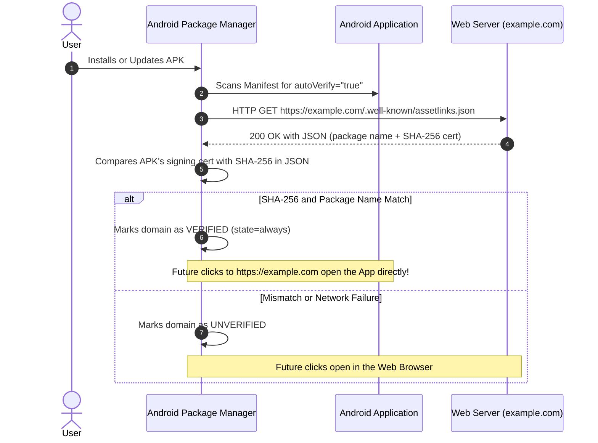
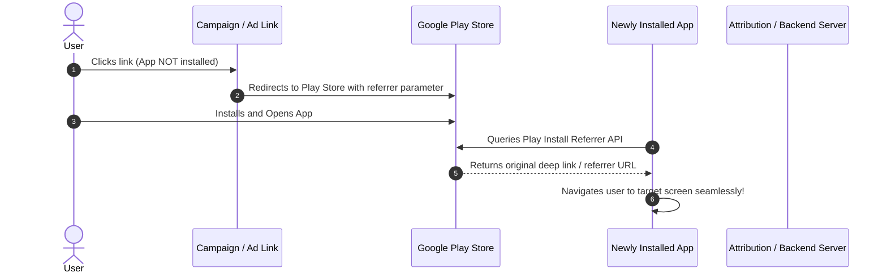

# 🎯 Top 10 Android Interview Questions: Deep Links & App Links

> High-yield, comprehensive questions and answers designed for Mid, Senior, and Lead Android Engineering technical interviews.

---

## 📋 Quick Index

1. [What is the difference between a Deep Link, a Web Link, and an Android App Link?](#q1-what-is-the-difference-between-a-deep-link-a-web-link-and-an-android-app-link)
2. [How does Android App Link verification work under the hood? What is the role of `assetlinks.json`?](#q2-how-does-android-app-link-verification-work-under-the-hood-what-is-the-role-of-assetlinksjson)
3. [What changed with Deep Links and App Links in Android 12 (API 31)?](#q3-what-changed-with-deep-links-and-app-links-in-android-12-api-31)
4. [What happens when two or more apps register the same custom scheme or intent filter? How do you prevent deep link hijacking?](#q4-what-happens-when-two-or-more-apps-register-the-same-custom-scheme-or-intent-filter-how-do-you-prevent-deep-link-hijacking)
5. [Why is `android.intent.category.DEFAULT` and `android.intent.category.BROWSABLE` required in the intent filter?](#q5-why-is-androidintentcategorydefault-and-androidintentcategorybrowsable-required-in-the-intent-filter)
6. [How does Activity launchMode affect deep link handling? Explain the role of `onNewIntent()` and `setIntent()`.](#q6-how-does-activity-launchmode-affect-deep-link-handling-explain-the-role-of-onnewintent-and-setintent)
7. [Does an `<intent-filter>` match query parameters (e.g., `?id=123&ref=promo`)? How should query parameters be handled?](#q7-does-an-intent-filter-match-query-parameters-eg-id123refpromo-how-should-query-parameters-be-handled)
8. [What is Deferred Deep Linking, and how is it implemented in Android?](#q8-what-is-deferred-deep-linking-and-how-is-it-implemented-in-android)
9. [How do you debug, test, and troubleshoot App Link domain verification failures using ADB?](#q9-how-do-you-debug-test-and-troubleshoot-app-link-domain-verification-failures-using-adb)
10. [What security risks and vulnerabilities are associated with Deep Links, and how do you mitigate them?](#q10-what-security-risks-and-vulnerabilities-are-associated-with-deep-links-and-how-do-you-mitigate-them)

---

## Q1: What is the difference between a Deep Link, a Web Link, and an Android App Link?

### 💡 Core Answer:
Android supports three distinct categories of links:

```
┌────────────────────────────────────────────────────────────────────────┐
│                        Link Categories in Android                      │
├──────────────────┬──────────────────┬──────────────────────────────────┤
│    Deep Link     │     Web Link     │        Android App Link          │
│  (Custom Scheme) │   (Standard Web) │    (Verified HTTP/HTTPS)         │
├──────────────────┼──────────────────┼──────────────────────────────────┤
│ myapp://product  │ https://site.com │ https://site.com/product         │
│ No Verification  │ No Verification  │ Digital Asset Links Verification │
│ App Chooser UI   │ App Chooser / Web│ Opens App Directly (No UI Dialog)│
│ Fails if no app  │ Opens Browser    │ Graceful fallback to Browser     │
└──────────────────┴──────────────────┴──────────────────────────────────┘
```

1. **Deep Link (Custom URI Scheme)**:
   - Uses a custom scheme defined by the app (e.g., `myapp://product/123`).
   - Requires no domain ownership or server verification.
   - If multiple apps declare the same scheme, Android presents a **Disambiguation Dialog** (App Chooser).
   - If the app is not installed, the link fails to open.

2. **Web Link (Standard HTTP/HTTPS)**:
   - Uses standard `http://` or `https://` schemes without verification.
   - On Android 11 and lower, it shows the App Chooser dialog asking the user whether to open the browser or the app.
   - On Android 12+, unverified web links **always open directly in the default browser**.

3. **Android App Link (Verified HTTP/HTTPS)**:
   - Available since Android 6.0 (API 23).
   - Uses `http://` or `https://` and includes `android:autoVerify="true"` in the intent filter.
   - Cryptographically verified against the website's `/.well-known/assetlinks.json`.
   - **Bypasses the disambiguation dialog completely** and opens directly in your app.
   - If the app is not installed, it seamlessly loads the web page in the user's browser.

---

## Q2: How does Android App Link verification work under the hood? What is the role of `assetlinks.json`?

### 💡 Core Answer:
Android App Links establish a two-way cryptographic trust between an Android application and a web domain:



### Key Technical Requirements for `assetlinks.json`:
1. **Location**: Must be hosted at the exact URL: `https://<domain>/.well-known/assetlinks.json`.
2. **HTTPS Only**: Must be served over HTTPS with a valid SSL/TLS certificate.
3. **No Redirects**: Must return HTTP `200 OK` directly. HTTP `301` or `302` redirects are treated as verification failures.
4. **Content-Type**: Must be `application/json`.
5. **Format**:
   ```json
   [
     {
       "relation": ["delegate_permission/common.handle_all_urls"],
       "target": {
         "namespace": "android_app",
         "package_name": "android.ai.applinkanddeeplink",
         "sha256_cert_fingerprints": [
           "14:6D:E9:7F:0F:52:EA:7B:42:25:28:B6:5E:21:48:86:16:D4:58:3B:A7:28:FD:44:8D:B8:2E:19:9B:9D:69:B2"
         ]
       }
     }
   ]
   ```

---

## Q3: What changed with Deep Links and App Links in Android 12 (API 31)?

### 💡 Core Answer:
Android 12 introduced major security and user experience overhauls to intent handling:

### 1. Mandatory `android:exported`
Any component (Activity, Service, Receiver) containing an `<intent-filter>` must explicitly specify `android:exported="true"` (or `false`). Leaving it unspecified causes a compile-time/manifest merge error.

### 2. Unverified Web Links No Longer Show the App Chooser
* **Before Android 12**: If an app registered an unverified `https://example.com` intent filter, clicking a link showed the Disambiguation Dialog ("Open with Chrome or My App?").
* **Android 12+**: If an HTTP/HTTPS domain is **not verified** via Digital Asset Links, Android **will never show the chooser dialog** — the link is redirected directly to the default web browser.

### 3. Per-Domain Approval State Machine
In Android 12+, domains are verified independently. Even if domain A fails, domain B can succeed. Users can also manually approve or revoke domains under:
`Settings > Apps > Default apps > Opening links > [Your App]`.

---

## Q4: What happens when two or more apps register the same custom scheme or intent filter? How do you prevent deep link hijacking?

### 💡 Core Answer:

### The Problem (Deep Link Hijacking):
Custom URI schemes like `myapp://` have no authority checking. Any third-party or malicious app can declare:
```xml
<intent-filter>
    <action android:name="android.intent.action.VIEW" />
    <category android:name="android.intent.category.DEFAULT" />
    <data android:scheme="myapp" />
</intent-filter>
```
When a link like `myapp://login?token=secret` is clicked:
1. Android displays the Disambiguation Dialog showing both apps.
2. If the user accidentally selects the malicious app, sensitive tokens or user data are leaked to the attacker.

### Prevention & Mitigation:
1. **Migrate to Android App Links**: Verified App Links use Digital Asset Links bound to your domain and cryptographic signing key. An attacker cannot verify your domain without your private signing key and DNS/web server access.
2. **Never Pass Secrets in Custom Schemes**: Avoid passing session tokens, passwords, or PII in deep link URIs. Use transient, one-time authentication codes exchanged via secure backend channels.
3. **Validate Incoming Intent Callers**: Verify the calling package if using explicit intents or `getCallingPackage()`.

---

## Q5: Why is `android.intent.category.DEFAULT` and `android.intent.category.BROWSABLE` required in the intent filter?

### 💡 Core Answer:

```xml
<intent-filter>
    <action android:name="android.intent.action.VIEW" />
    <category android:name="android.intent.category.DEFAULT" />
    <category android:name="android.intent.category.BROWSABLE" />
    <data android:scheme="https" android:host="www.example.com" />
</intent-filter>
```

### 1. `android.intent.category.DEFAULT`:
- When an app executes `startActivity(intent)`, Android automatically adds `category.DEFAULT` to the implicit Intent.
- If your activity's intent filter does not declare `category.DEFAULT`, the Android PackageManager **will fail to resolve the intent**, throwing an `ActivityNotFoundException`.

### 2. `android.intent.category.BROWSABLE`:
- Tells the system that this activity can be safely invoked by a web browser (e.g., Chrome, Samsung Internet) or HTML web links (`<a href="...">`).
- Without `BROWSABLE`, tapping a link inside a browser or WebView **will not open your app**.

---

## Q6: How does Activity launchMode affect deep link handling? Explain the role of `onNewIntent()` and `setIntent()`.

### 💡 Core Answer:

### 1. `standard` (Default Launch Mode):
- Every time a deep link is clicked, Android creates a **new instance** of the Activity on top of the task stack.
- `onCreate()` is invoked every time.
- **Problem**: Can lead to redundant Activity instances and a broken back stack (e.g., User presses Back 5 times through 5 duplicate product screens).

### 2. `singleTask` or `singleTop`:
- If an instance of the Activity already exists in the task, Android brings that existing instance to the foreground instead of creating a new one.
- The new Intent is delivered via **`onNewIntent(intent: Intent)`** instead of `onCreate()`.

### Why `setIntent(intent)` is Critical:
```kotlin
override fun onNewIntent(intent: Intent) {
    super.onNewIntent(intent)
    // CRITICAL: Without this line, getIntent() returns the OLD intent!
    setIntent(intent)
    processDeepLink(intent)
}
```
If you omit `setIntent(intent)`, any subsequent call to `getIntent()` anywhere in the Activity lifecycle (or in child fragments) will return the **original intent that first created the activity**, causing stale data bugs.

---

## Q7: Does an `<intent-filter>` match query parameters (e.g., `?id=123&ref=promo`)? How should query parameters be handled?

### 💡 Core Answer:
### **No! Android Intent Filters never match query parameters.**

The `<data>` element in an intent filter only matches:
- `scheme` (e.g., `https`, `myapp`)
- `host` (e.g., `www.example.com`)
- `port` (e.g., `8080`)
- `path`, `pathPrefix`, or `pathPattern` (e.g., `/product/*`)

### How Query Parameters Must Be Handled:
Query parameters must be extracted programmatically inside your Activity or ViewModel from `intent.data`:

```kotlin
val uri: Uri? = intent.data

// Read single query parameter
val promoCode: String? = uri?.getQueryParameter("promo")

// Read multiple query parameters with the same key (?tag=android&tag=compose)
val tags: List<String>? = uri?.getQueryParameters("tag")

// Read all query parameter names
val paramNames: Set<String>? = uri?.queryParameterNames
```

---

## Q8: What is Deferred Deep Linking, and how is it implemented in Android?

### 💡 Core Answer:



### Definition:
- **Standard Deep Linking**: Works only if the app is already installed on the device.
- **Deferred Deep Linking**: Works when the app is **not yet installed**. It routes the user to the Google Play Store to install the app, and upon first launch, seamlessly directs them to the original destination.

### Implementation Approaches:
1. **Google Play Install Referrer API**:
   - The campaign link redirects to `https://play.google.com/store/apps/details?id=com.app&referrer=target_url%3Dproduct_123`.
   - On first launch, the app uses `InstallReferrerClient` to read the referrer string.
2. **Third-Party Attribution SDKs**:
   - Tools like Branch.io, AppsFlyer, or Adjust use fingerprinting and Install Referrer to match install sessions with click sessions.

---

## Q9: How do you debug, test, and troubleshoot App Link domain verification failures using ADB?

### 💡 Core Answer:

### 1. Check Verification Status:
```bash
adb shell pm get-app-links <package_name>
```
**Output Example**:
```
Package: android.ai.applinkanddeeplink
Domains:
    www.example.com: verified
    example.com: 1024 (legacy_failure)
```

### 2. Force Verification Re-Check:
```bash
adb shell pm verify-app-links --re-verify <package_name>
```

### 3. Manually Force State to Verified (Local Testing):
When testing on local machines without a production HTTPS server hosting `assetlinks.json`:
```bash
# State 2 = 'always' / verified
adb shell pm set-app-links --package <package_name> 2 www.example.com
```

### Top 4 Causes of Verification Failure in Production:
1. **Wrong SHA-256 Fingerprint**: Testing with Play App Signing where Google re-signs the APK with a different key than the local upload keystore.
2. **HTTP Redirect**: `assetlinks.json` redirected (e.g., `http` to `https` or trailing slash redirect).
3. **Invalid Content-Type**: Server returned `text/html` instead of `application/json`.
4. **Subdomain Not Declared**: `example.com` verified, but `www.example.com` or `blog.example.com` was missing from `assetlinks.json` or manifest.

---

## Q10: What security risks and vulnerabilities are associated with Deep Links, and how do you mitigate them?

### 💡 Core Answer:

| Vulnerability | Attack Vector | Mitigation Strategy |
| :--- | :--- | :--- |
| **Deep Link Hijacking** | Malicious app registers the same custom scheme (`myapp://`) to steal traffic. | Use **Android App Links** with domain verification. |
| **Intent Spoofing / Injection** | An attacker creates an explicit or implicit intent targeting internal activities. | Ensure internal activities have `android:exported="false"`. Use exported activities strictly as routers. |
| **Open Redirect Vulnerability** | Deep link takes a destination URL parameter (`myapp://open?url=https://evil.com`) and loads it in a WebView. | Maintain an **allowlist** of verified internal domains before loading URLs in WebViews. |
| **CSRF / Unauthorized State Change** | A link executes an action immediately upon click (e.g., `myapp://transfer?amount=1000&to=hacker`). | Require **explicit user confirmation** (biometrics, PIN, or modal confirmation) before executing state-changing operations. |
| **Path Traversal Attacks** | Malicious path parameters like `myapp://read?file=../../secret.txt`. | Sanitize and validate all URI path segments against safe alphanumeric patterns. |

---

### 🎓 Summary Cheatsheet for Candidates
- **Deep Link**: Custom scheme (`myapp://`), unverified, disambiguation dialog.
- **App Link**: HTTPS scheme, verified via `assetlinks.json`, direct open, graceful web fallback.
- **Android 12+**: Unverified web links go directly to browser; `exported="true"` is mandatory.
- **Manifest**: Must have `ACTION_VIEW`, `CATEGORY_DEFAULT`, `CATEGORY_BROWSABLE`.
- **Activity**: Use `singleTask`, implement `onNewIntent()`, and remember `setIntent(intent)`.
